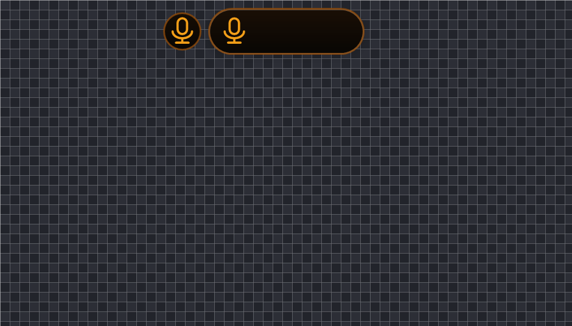
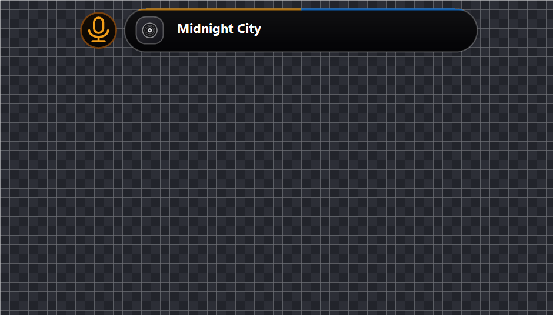
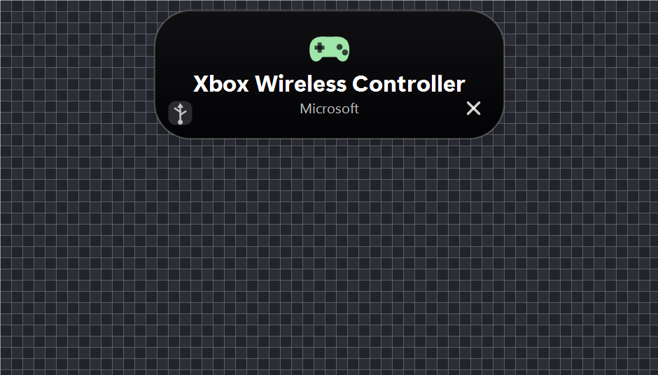

# Dynamic Island for Windows 11

An iPhone-style Dynamic Island for the Windows desktop: a black pill fused to the top
edge of the screen that springs open on hover and doubles as a status surface for
whatever is happening on the machine.

Built with nothing but the in-box .NET Framework compiler and Win32/GDI+. No installer
framework, no external packages, one ~130 KB executable.

## Get it

**[⬇ Download DynamicIsland.zip](https://github.com/Maksik4038/dynamic-island-windows/releases/latest/download/DynamicIsland.zip)** — ready to run.

Unpack it anywhere and start `DynamicIsland.exe`. The executable is already inside, so no
compiler and no Windows SDK are needed. To have it start with Windows and appear in the
Start Menu:

```powershell
powershell -ExecutionPolicy Bypass -File Install.ps1
```

If it will not start, the bundled diagnostic says why:

```powershell
powershell -ExecutionPolicy Bypass -File Diagnose.ps1
```

Requirements: Windows 11 and the .NET Framework 4.x, which ships with Windows.


## What it shows

| State | Appearance |
|---|---|
| Idle | a plain black pill — nothing on it |
| Track playing | disc + track title, draggable seek bar, tap right side to skip |
| Microphone in use | orange microphone glyph and orange rim |
| Music **and** microphone | the microphone detaches into its own small island on the left |
| Stopwatch / timer running | a single small glyph |
| Timer finished / alarm ringing | the island unfurls downward into a card with controls |
| USB / Bluetooth device connected | card with a device icon, transport badge and battery |
| File downloaded | progress bar, then a green tick in a green circle |
| Bluetooth / Wi-Fi switched | a mark for three seconds |
| Keyboard layout switched | the code: `rus`, `eng`, `ukr` … |
| Application opened | its icon, centred, for three seconds |
| Screen locked | a small padlock beside the island |

<p align="center">
  
  
  
  
</p>

More states are in [`shots/`](shots) — one PNG per state, rendered by the app itself.

## Controls

- **Hover** the pill to expand the full panel (waveform, date, volume and brightness).
- **Drag** the two bars to set system volume and screen brightness.
- **Click** the speaker glyph to mute; **scroll** over the island to change volume.
- **Right-click the tray icon** for the resting width, autostart, settings and quit.

Resting width is configurable from a dot (16 px) up to 220 px; below capsule height the
island becomes a true circle.

## Building

Requirements: .NET Framework 4.x (ships with Windows) and the **Windows SDK 10** (needed
only to compile — it supplies `Windows.winmd` for the media API).

```powershell
powershell -ExecutionPolicy Bypass -File Build.ps1
powershell -ExecutionPolicy Bypass -File Build.ps1 -Run
```

`Build.ps1` finds the newest SDK itself. To compile by hand:

```powershell
$winmd = 'C:\Program Files (x86)\Windows Kits\10\UnionMetadata\10.0.28000.0\Windows.winmd'
$wrt   = "$env:WINDIR\Microsoft.NET\Framework64\v4.0.30319\System.Runtime.WindowsRuntime.dll"
$sr    = "$env:WINDIR\Microsoft.NET\Framework64\v4.0.30319\System.Runtime.dll"

csc /target:winexe /out:DynamicIsland.exe `
    /reference:System.dll /reference:System.Drawing.dll /reference:System.Windows.Forms.dll `
    /reference:System.Core.dll /reference:System.Management.dll `
    /reference:$sr /reference:$winmd /reference:$wrt `
    DynamicIsland.cs Activities.cs ActivityPipe.cs Privacy.cs Media.cs Devices.cs Sensors.cs Settings.cs
```

## Installing

```powershell
powershell -ExecutionPolicy Bypass -File Install.ps1
```

Copies the app to `%LOCALAPPDATA%\DynamicIsland`, creates Start Menu and Desktop
shortcuts and registers autostart through the HKCU `Run` key — no administrator rights.
To remove everything: `Install.ps1 -Uninstall`.

## Live activities from the command line

Any script can drive the island. If it is already running, the second instance forwards
the command and exits.

```powershell
$DI = "$env:LOCALAPPDATA\DynamicIsland\DynamicIsland.exe"

& $DI stopwatch start          # also: pause, reset, stop
& $DI timer 10m "Focus"        # also: 90s, 1h30m; pause, reset, +5m, dismiss
& $DI alarm 07:30              # snooze = +10 min, dismiss
& $DI notify "Build done" "3 tests failed"
& $DI lang rus
& $DI radio bluetooth on
& $DI download "setup.exe" 0.42
& $DI downloaded "setup.exe"
& $DI app Photoshop
```

Full command reference: [COMMANDS.md](COMMANDS.md).

## Diagnostics

```powershell
& $DI --selftest       # volume, brightness, battery, DPI, taskbar geometry
& $DI --privacy        # watch microphone/camera capture live
& $DI --probe-media    # is the media session API reachable?
& $DI --watch          # what the language / radio / window watchers currently see
& $DI --snapshot DIR   # render every state to PNG (used for the shots above)
```

## If it does not start

Run the diagnostic first — it checks everything that commonly goes wrong and prints the
result of the built-in self test:

```powershell
powershell -ExecutionPolicy Bypass -File Diagnose.ps1
```

The most frequent causes, in order:

| Symptom | Cause | Fix |
|---|---|---|
| `DynamicIsland.exe` is not there | build output is not stored in the repository | `Build.ps1` |
| Build stops at `Windows.winmd not found` | Windows SDK 10 is missing | install it, or grab a Release exe |
| Nothing happens at all, no window | .NET Framework 4.x missing | install .NET Framework 4.8 |
| Window flashes and vanishes | a startup exception | there is now a message box, and `island-error.log` next to the exe |
| It runs, but no island on screen | the app started fine — look for the tray icon | the pill is at the very top centre, y = 0 |
| Nothing after downloading from GitHub | the file is flagged as from the internet | `Unblock-File .\DynamicIsland.exe` |

Startup failures used to be completely silent: the executable is a GUI-subsystem build, so
an exception produced no window, no console output and no clue. The entry point now reports
any fatal exception in a message box **and** appends it to `island-error.log` beside the exe.

## How it works

A layered window (`WS_EX_LAYERED` + `UpdateLayeredWindow`) over a persistent 32bpp DIB
back-buffer, so the pill is genuinely antialiased per-pixel rather than a clipped
rectangle. Motion comes from a critically damped spring integrated in 2 ms substeps, so
it feels the same at 60 Hz and 144 Hz.

Everything is read through plain Win32, COM and the WinRT projection:

| Feature | Source |
|---|---|
| Volume | CoreAudio `IAudioEndpointVolume` |
| Screen brightness | Dxva2 `Get/SetMonitorBrightness` |
| Now playing + artwork | WinRT `GlobalSystemMediaTransportControlsSessionManager` |
| Microphone in use | CoreAudio capture sessions |
| USB / Bluetooth devices | WMI `Win32_DeviceChangeEvent` + `Win32_PnPEntity` |
| Bluetooth / Wi-Fi state | WinRT `Windows.Devices.Radios` |
| Keyboard layout | `GetKeyboardLayout` of the foreground thread |
| Downloads | file watching (see limitations) |
| Lock screen | `OpenInputDesktop` / `SwitchDesktop` |

The media path is validated in a **child process** before the widget uses it: a wrong
call against a WinRT vtable would otherwise take the whole app down.

## Если не запускается (по-русски)

Запустите диагностику — она проверит всё, что обычно мешает, и напечатает результат
встроенного самотеста:

```powershell
powershell -ExecutionPolicy Bypass -File Diagnose.ps1
```

Частые причины:

| Что видите | В чём дело | Что делать |
|---|---|---|
| Файла `DynamicIsland.exe` нет | собранный exe не хранится в репозитории | запустить `Build.ps1` |
| Сборка падает: `Windows.winmd not found` | не установлен Windows SDK 10 | установить SDK или взять готовый exe из Releases |
| Ничего не происходит, окна нет | не установлен .NET Framework 4.x | поставить .NET Framework 4.8 |
| Окно мелькнуло и исчезло | исключение при запуске | теперь появится окно с ошибкой и файл `island-error.log` рядом с exe |
| Работает, но острова не видно | приложение запустилось нормально | ищите значок в трее; остров в самом верху по центру, y = 0 |
| После скачивания с GitHub ничего | файл помечен как из интернета | `Unblock-File .\DynamicIsland.exe` |

Раньше сбой при запуске был **полностью молчаливым**: exe собран как GUI-приложение, поэтому
исключение не показывало ни окна, ни вывода в консоль. Теперь любая фатальная ошибка
попадает в окно сообщения и в `island-error.log` рядом с exe.

## Honest limitations

These are real restrictions of the platform, not unfinished work:

- **Browser download progress cannot be read.** Chrome and Edge keep transfer state in
  their own profile databases; there is no public API for another process's download.
  The island detects a finished file in `Downloads`, and shows a progress bar for partial
  files when the browser leaves them visible.
- **Download percentage is exact only when reported by the caller** (`download "name" 0.42`).
  Otherwise an indeterminate bar is shown rather than an invented number.
- **Application icons are best-effort.** `WM_GETICON` often returns nothing and
  `ExtractIconEx` can fail on elevated processes; a coloured monogram tile is used as the
  fallback.
- **Camera activity is not implemented.** The ConsentStore registry only records apps that
  go through the capability broker (verified: it does not update for the Windows Camera
  app), `AppCapability` requires package identity, and device state cannot be distinguished
  from a permissions failure. The microphone *is* detected reliably, through CoreAudio.
- **Windows' own Clock app alarms/timers cannot be imported** — the app keeps them in an
  internal store with no accessible file (`LocalState` contains UI state only).

## License

MIT — see [LICENSE](LICENSE).
